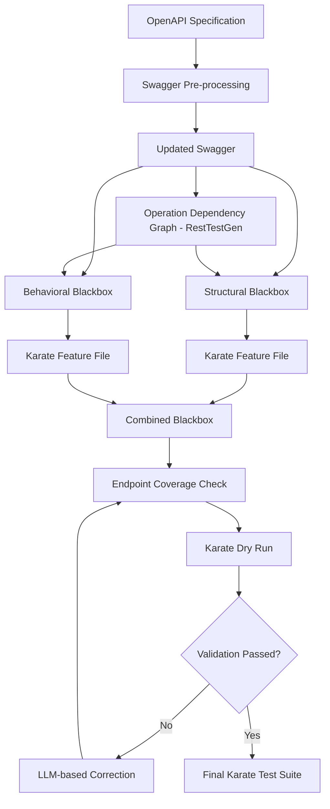

# LATGA — LLM-Assisted Test Generation for APIs


## 專案簡介｜Overview

LATGA（LLM-Assisted Test Generation for APIs）是一套結合大型語言模型（Large Language Model, LLM）與操作相依性分析的 Web API 自動化黑箱測試案例生成系統，為本人於國立臺灣海洋大學碩士期間所開發的論文研究專案。

本研究以 OpenAPI Specification（OAS）作為主要輸入，結合操作相依圖（Operation Dependency Graph, ODG）、Few-shot Prompting、使用者行為模擬及自動化腳本驗證，生成涵蓋不同測試情境與操作流程的 Karate 測試腳本。

相較於傳統基於 API 規格的自動化測試方法，LATGA 進一步利用 LLM 的語意理解與推理能力，探索 API 操作之間的關聯性及潛在使用情境，以提升測試案例的多樣性與工作流程完整性。

## 研究動機｜Motivation

傳統的 Web API 自動化黑箱測試工具，多依據 OpenAPI 規格中的參數型別、限制條件及操作相依關係生成測試案例。

然而，實際使用情境通常涉及多個 API 操作之間的互動，僅針對個別端點進行測試，可能難以充分涵蓋完整的使用者操作流程。

因此，本研究探討如何利用大型語言模型改善以下問題：

- API 規格缺少完整的參數範例及限制條件。
- 測試案例缺乏具備實際語意的輸入資料。
- 測試情境過度集中於單一 API 操作。
- 缺乏貼近實際使用者行為的跨端點測試流程。
- LLM 生成的測試腳本可能存在語法錯誤或端點覆蓋不足等問題。

## 系統特色｜Key Features

- **OpenAPI Pre-processing**：分析及補強 OpenAPI 規格中的參數資訊與限制條件。
- **Operation Dependency Analysis**：利用 RestTestGen 建立操作相依圖，作為測試流程生成的依據。
- **Structural Blackbox Testing**：根據 API 結構與操作相依性生成測試案例。
- **Behavioral Blackbox Testing**：透過前端介面生成及使用者行為模擬建立測試情境。
- **Combined Blackbox Testing**：整合不同生成策略的測試案例，保留具有差異性的測試情境。
- **Equivalence Partitioning**：利用等價類別劃分與邊界值分析提高測試輸入的多樣性。
- **Automated Script Validation**：透過端點覆蓋檢查與 Karate Dry Run 驗證測試腳本。
- **LLM-Based Error Correction**：將驗證結果回饋至 LLM，輔助修正生成腳本。

## 系統架構｜System Architecture

系統主要由以下模組組成：

1. OpenAPI Specification Pre-processing
2. Operation Dependency Graph Generation
3. Structural Blackbox Testing
4. Behavioral Blackbox Testing
5. Test Case Integration
6. Karate Script Validation & Correction

透過模組化的生成流程，將 API 規格分析、測試情境設計、腳本生成及驗證分離，降低單次 LLM 生成任務的複雜度，並提高各階段輸出的可控性。

## 測試案例生成策略｜Test Generation Strategies

### 1. Structural Blackbox Testing (Static)

以 API 規格及操作相依圖作為主要測試案例生成依據，結合 Few-shot Prompting，引導 LLM 分析 API 的參數限制、回應狀態及操作關係。

主要流程：

- 讀取經過前處理的 OpenAPI Specification。
- 分析 Operation Dependency Graph。
- 透過 Few-shot Examples 引導測試案例生成。
- 建立正常、異常及邊界值測試情境。
- 生成可由 Karate Framework 執行的測試腳本。

此方法著重於 API 結構分析、端點覆蓋及規格導向的測試案例生成。

### 2. Behavioral Blackbox Testing (Dynamic)

透過 LLM 根據 API 規格與操作相依圖生成簡易前端介面，並模擬使用者操作行為，建立更貼近實際使用情境的測試流程。

主要流程：

- 根據 OpenAPI Specification 與 ODG 生成簡易前端介面。
- 利用另一個 LLM 模擬使用者操作流程。
- 將操作行為轉換為 Gherkin 測試情境。
- 整合 API 規格與行為腳本。
- 生成對應的 Karate 測試案例。

此方法著重於跨端點操作、使用者行為及完整工作流程的測試。

### 3. Combined Blackbox Testing

整合 Structural Blackbox 與 Behavioral Blackbox 兩種策略的生成結果，結合規格導向及行為導向測試的特色。

整合過程包含：

- 辨識並合併重複的測試情境。
- 保留具有差異性的測試案例。
- 整合正常、異常及邊界測試。
- 依操作相依關係調整測試案例順序。
- 輸出整合後的 Karate Feature File。




## 測試設計｜Test Case Design

本研究結合等價類別劃分（Equivalence Partitioning）與邊界值分析（Boundary Value Analysis），引導 LLM 針對適用的 API 參數生成不同類型的測試輸入。

| Test Input | Description |
|---|---|
| Normal Value | 符合規格的代表性正常值 |
| Maximum Value | 規格允許的最大值 |
| Minimum Value | 規格允許的最小值 |
| Above Maximum | 超出規格上限的數值 |
| Below Minimum | 低於規格下限的數值 |
| Invalid Value | 不符合型別、格式或其他規格限制的輸入 |

透過上述測試設計，使生成結果不僅涵蓋正常操作情境，也包含異常輸入及邊界條件。

## 腳本驗證與自動修正｜Validation & Correction

為降低 LLM 生成測試腳本時可能發生的錯誤，本系統建立後處理與驗證流程：

- 檢查測試腳本是否涵蓋 OpenAPI 中定義的 API 操作。
- 使用 Karate Dry Run 進行腳本語法與結構檢查。
- 收集並整理驗證過程中的錯誤資訊。
- 將錯誤摘要與原始腳本提供給 LLM 進行修正。
- 輸出修正後的 Karate Feature File。

此流程旨在提升生成腳本的完整性與可執行性，但靜態驗證通過並不代表所有測試案例皆能於實際 API 環境中成功執行。

## 技術與工具｜Tech Stack

| Category | Technology |
|---|---|
| Programming Language | Java |
| Backend Framework | Spring Boot |
| AI Integration | Spring AI |
| Large Language Models | GPT-4.1, Claude Sonnet 4 |
| Prompt Engineering | Few-shot Prompting |
| API Specification | OpenAPI / Swagger |
| Dependency Analysis | RestTestGen |
| Testing Framework | Karate |
| Test Scenario Language | Gherkin |
| Build Tool | Maven |
| Version Control | Git / GitHub |

## 實驗設計與評估｜Experimental Evaluation

本研究選用九個不同應用領域的公開 Web API 作為實驗對象，以評估 LATGA 在不同 API 規模、參數限制及操作相依關係下的測試案例生成能力。

| API | Domain |
|---|---|
| Bandsintown | Artist & Event Information |
| Nager.Date | Public Holidays |
| Billingo | Billing & Invoice Management |
| CircleCI | CI/CD |
| Spotify | Music Streaming |
| Highlightly Basketball Highlights | Sports Information |
| News API | News Information |
| Lorem Picsum | Image Services |
| South Park Quotes | Entertainment |

### 評估指標｜Evaluation Metrics

本研究透過以下五項指標評估生成測試案例的品質：

| Metric | Description |
|---|---|
| Endpoint Coverage | API 操作與端點的覆蓋程度 |
| Workflow Completeness | 跨端點操作與工作流程的完整性 |
| Scenario Diversity | 測試情境的多樣性 |
| Equivalence Partitioning | 單一 API 操作的等價類別測試完整性 |
| Overall Completeness | 整體測試案例的完整程度 |

### 比較方法｜Baseline Comparison

以 RestTestGen 生成的黑箱測試案例作為比較基準，分析不同測試生成策略在端點覆蓋、工作流程及測試情境多樣性等方面的差異。

為統一測試腳本格式，另外開發 Rest-Assured 至 Karate 的腳本轉換工具，輔助後續實驗比較。

### 研究結果｜Research Findings

- Structural Blackbox 能利用結構化 API 規格及操作相依資訊建立較具規格一致性的測試案例。
- Behavioral Blackbox 透過使用者行為模擬，展現生成較豐富操作情境與跨端點工作流程的能力。
- Combined Blackbox 旨在結合兩種方法的特色，提高整體測試情境的完整性。
- 不同 LLM 評估模型對於測試策略的評價存在差異，顯示 LLM-based Evaluation 仍具有模型偏差及評估一致性等限制。

## 個人開發與研究貢獻｜My Contributions

- 規劃及設計 LLM 輔助 Web API 自動化測試生成方法。
- 建立基於 Spring Boot 與 Spring AI 的自動化測試生成系統。
- 設計 OpenAPI 規格前處理及參數資訊補強流程。
- 整合 RestTestGen 的 Operation Dependency Graph。
- 設計 Structural 與 Behavioral Blackbox 測試生成策略。
- 建立多階段 Prompt Engineering 與 Few-shot Examples。
- 實作測試案例整合、端點覆蓋檢查及腳本驗證機制。
- 開發 Rest-Assured 至 Karate 的測試腳本轉換工具。
- 規劃實驗對象、評估指標及比較方法。
- 分析測試結果、生成策略差異與研究限制。

## 專案結構｜Project Structure

- `src/` — Java 原始碼、系統服務及相關設定。
- `prompts/` — 各生成階段使用的 Prompt Templates。
- `fewshot/` — Few-shot Prompting 所使用的範例。
- `.mvn/` — Maven Wrapper 相關設定。
- `pom.xml` — Maven 專案與相依套件設定。
- `mvnw` / `mvnw.cmd` — Maven Wrapper 執行腳本。

## 執行方式｜Getting Started

### Requirements

- Java Development Kit（JDK）
- Maven
- Spring Boot
- Karate Framework
- Supported LLM API Keys

### Installation

Clone this repository:

```bash
git clone https://github.com/p89108989/LATGA.git
cd LATGA
```

### API Configuration

依據專案所使用的 LLM，在 `application.properties` 中完成對應的 API Key 與模型設定。

建議透過環境變數管理 API Key，避免將金鑰直接提交至 Git Repository。

### Run the Application

```bash
mvn spring-boot:run
```

系統依據所選擇的測試生成策略，處理 API 規格及相關輸入資料，並生成對應的 Karate 測試腳本（`.feature`）。

測試腳本的實際執行可能需要額外設定 API 認證資訊及測試環境。

## 研究限制｜Limitations

- 測試案例品質可能受到 LLM 模型能力及 Prompt 設計影響。
- 不完整的 OpenAPI 規格可能影響生成結果。
- LLM 生成結果具有非確定性。
- 外部 API 的認證機制、服務狀態及 Rate Limit 可能影響測試執行。
- LLM 評估結果可能存在模型偏差。
- 靜態腳本驗證無法完全取代實際 API 測試。

## 相關研究與工具｜References

- [RestTestGen](https://github.com/SeUniVr/RestTestGen)
- [Karate Framework](https://github.com/karatelabs/karate)
- [OpenAPI Specification](https://spec.openapis.org/)
- [Spring AI](https://spring.io/projects/spring-ai)

## 專案資訊｜Project Information

| Item | Description |
|---|---|
| Project Type | Master's Thesis Research |
| Institution | National Taiwan Ocean University |
| Research Area | Software Testing / Software Engineering |
| Research Topic | LLM-Assisted Web API Testing |
| Development Type | Individual Research & Development |
| Development Status | Academic Research Project |

本專案為碩士論文研究成果，旨在探索大型語言模型於自動化軟體測試領域的應用，並結合傳統軟體測試方法與生成式 AI，建立具備多種測試生成策略的 Web API 黑箱測試系統。
